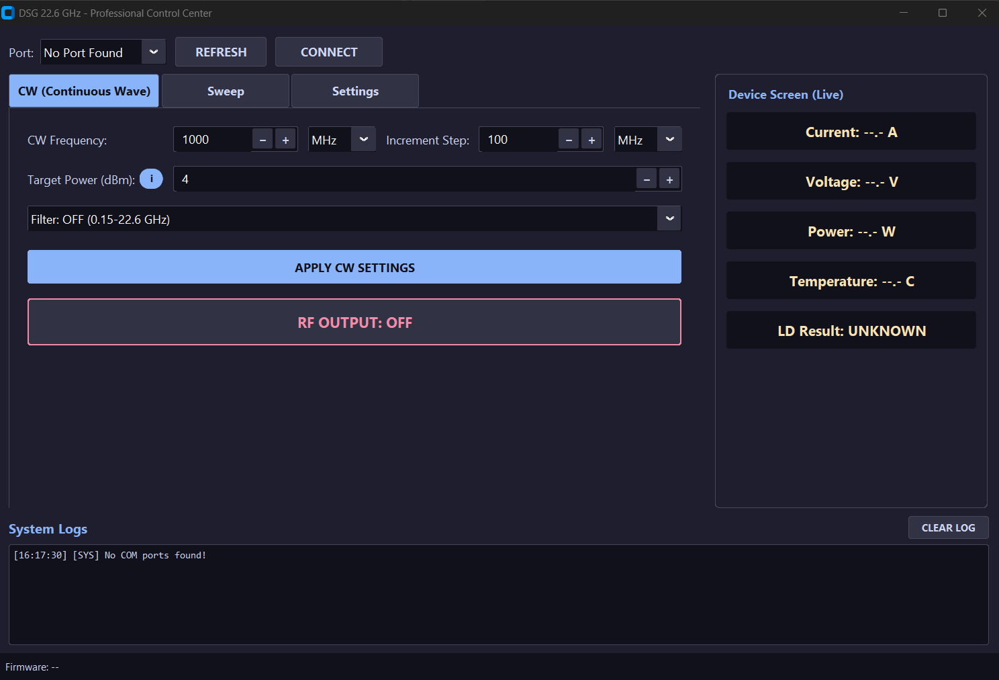
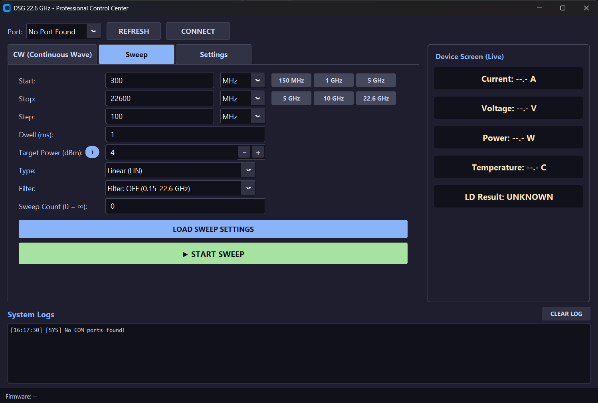
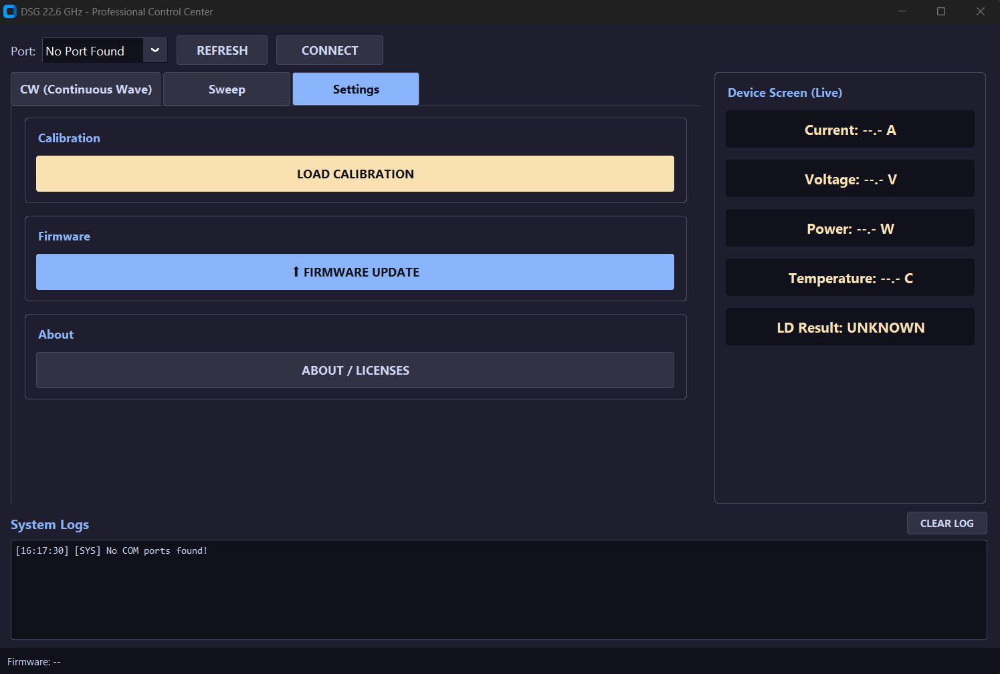

## DSG Control UI (Desktop Application)

A Python-based desktop GUI (**"DSG 22.6 GHz - Professional Control Center"**) is provided to control the DSG signal generator over USB. It lets you generate a continuous-wave (CW) signal at a specific frequency and power, run frequency sweeps, load device-specific normal and high-power calibration files, update firmware, and monitor live telemetry (current, voltage, power, temperature, and PLL lock status).

The current desktop UI version is **1.0.0** and is implemented with **CustomTkinter**.

### Requirements

- **Python 3.10 or newer** (developed and tested with Python 3.14.5; other 3.10+ versions are expected to work but have not been explicitly tested)
- A DSG device
- A **USB-C cable**

### Installation

1. Clone or download this repository.
2. Navigate to the UI source folder:
   ```bash
   cd ui
   ```
   *(adjust this path to match the actual folder name in this repo)*
3. (Recommended) Create and activate a virtual environment:
   ```bash
   python -m venv .venv

   # Windows
   .venv\Scripts\activate

   # macOS/Linux
   source .venv/bin/activate
   ```
4. Install the required dependencies:
   ```bash
   pip install -r requirements.txt
   ```

   If you are installing the dependencies manually:
   ```bash
   pip install customtkinter pyserial esptool
   ```

### Required Libraries

| Library | Purpose |
|---|---|
| [`CustomTkinter`](https://pypi.org/project/customtkinter/) | Graphical user interface framework |
| [`pyserial`](https://pypi.org/project/pyserial/) | Serial (USB) communication with the DSG device |
| [`esptool`](https://pypi.org/project/esptool/) | Flashes ESP32-S3 firmware (`.bin`) directly from the UI's Firmware Update feature |

`darkdetect` and `packaging` may also appear in the Python environment because they are installed as dependencies of CustomTkinter and normally do not need to be installed separately.

*(`sys`, `os`, `re`, `time`, `queue`, `datetime`, `threading`, `subprocess`, `tkinter`, `webbrowser`, and `collections` are part of the Python standard library and require no separate installation.)*

### Connecting to the Device

1. Connect the DSG device to your PC using a **USB-C cable** — the **USB-C end plugs into the DSG**.
2. Run the main GUI script:
   ```bash
   python gui.py
   ```
3. In the top-left **Port** dropdown, click **REFRESH** to scan for available serial ports, then select the port corresponding to your DSG device.
4. Click **CONNECT**. Once connected, the UI reads the current device settings and synchronizes the desktop controls with the DSG screen.

---

### CW (Continuous Wave) Tab



The **CW** tab is the default tab shown on startup. It configures the DSG to output a continuous signal at a single, fixed frequency and power level.

| Control | Description |
|---|---|
| **CW Frequency** | The output frequency. Enter the numeric value in the field, then select the unit (**KHz**, **MHz**, or **GHz**) from the dropdown next to it. |
| **Increment Step** | The step size used when incrementing/decrementing the CW Frequency value with the field's `-` / `+` buttons. |
| **Target Power (dBm)** | The requested output power level, in dBm. The `i` button shows the available Target Power ranges. If the requested power is higher than the available calibrated value, the DSG applies the highest available value and the GUI updates to show the actual applied Target Power. |
| **Filter** | Toggles the internal filter **ON** or **OFF** (see below for the effect of this setting). |
| **APPLY CW SETTINGS** | Sends the configured frequency, power, and filter settings from the UI to the device. The actual applied settings are read back from the DSG and reflected in the GUI. |
| **RF OUTPUT: OFF / ON** | Toggles the RF output. Click once to switch it to **RF OUTPUT: ON** and start generating the signal; click again to turn it back off. |

**Target Power information shown by the UI:**

- **Filter ON**
  - 2 GHz – 8 GHz: up to **12 dBm**
  - 8 GHz – 16 GHz: up to **10 dBm**
  - 16 GHz – 18 GHz: up to **10 dBm**
- **Filter OFF**
  - 150 MHz – 19 GHz: up to **18 dBm**
  - 19 GHz – 21 GHz: up to **17 dBm**
  - 21 GHz – 22.6 GHz: up to **15 dBm**

The actual applied Target Power can be lower if the available calibration data does not support the requested value. The GUI displays the value actually applied by the DSG.

**Filter behavior:**
- **Filter: OFF** — allows output across the full **0.15–22.6 GHz** range. However, when the filter is off, the output signal contains visible **harmonics** alongside the fundamental (main) signal.
  <!-- Optional: insert a spectrum screenshot showing the fundamental signal with visible harmonics when Filter is OFF -->
- **Filter: ON** — restricts the usable range to **2–18 GHz**, but suppresses the harmonics by roughly **40 dB**, leaving a clean output with only the fundamental signal present.
  <!-- Optional: insert a spectrum screenshot showing the clean fundamental signal (harmonics suppressed) when Filter is ON -->

**Typical CW workflow:**
1. Enter the desired **CW Frequency** and unit.
2. Set the **Target Power (dBm)**.
3. Choose the **Filter** mode based on your required frequency range and harmonic suppression needs.
4. Click **APPLY CW SETTINGS** to push the configuration to the device.
5. Confirm the applied Target Power shown in the GUI if the requested level was above the available calibrated value.
6. Click **RF OUTPUT: OFF** to turn it **ON** and start generating the signal.

---

### Sweep Tab



The **Sweep** tab configures the DSG to automatically scan across a range of frequencies, from a start frequency to a stop frequency, in defined steps.

| Control | Description |
|---|---|
| **Start** | The frequency at which the sweep begins. Enter the value and select its unit (**KHz/MHz/GHz**). Quick-select buttons (**150 MHz**, **1 GHz**, **5 GHz**) are provided for common start values. |
| **Stop** | The frequency at which the sweep ends. Quick-select buttons (**5 GHz**, **10 GHz**, **22.6 GHz**) are provided for common stop values. |
| **Step** | The frequency increment used to move from **Start** to **Stop** — i.e. how large each jump is between one sweep point and the next. |
| **Dwell (ms)** | The amount of time, in milliseconds, that the device holds/transmits at each individual frequency step before moving to the next one. |
| **Target Power (dBm)** | The requested output power level used throughout the sweep. The `i` button shows the same Target Power information used by CW mode. After loading the settings, the GUI reads back and displays the Target Power actually allowed for the complete sweep range. |
| **Type** | The frequency progression mode for the sweep: **Linear (LIN)** or **Logarithmic (LOG)**. |
| **Filter** | Toggles the internal filter **ON** or **OFF**. The CW and Sweep filter selections are synchronized because they control the same physical filter state. |
| **Sweep Count (0 = ∞)** | The number of full sweep cycles (Start → Stop) to run before stopping automatically. Set to **0** to sweep continuously. |
| **LOAD SWEEP SETTINGS** | Sends the configured sweep parameters (Start, Stop, Step, Dwell, Power, Type, Filter, Count) from the UI to the device. |
| **START SWEEP / STOP SWEEP** | Starts the sweep using the most recently loaded settings, or aborts the active sweep. |

The UI validates that both Start and Stop are within the supported frequency range and does not allow **Start > Stop** or **Start = Stop**.

**Typical Sweep workflow:**
1. Enter the **Start** frequency and unit (or use a quick-select button).
2. Enter the **Stop** frequency and unit (or use a quick-select button).
3. Set the **Step** size — the frequency increment between sweep points.
4. Set the **Dwell (ms)** — how long the device stays on each frequency point.
5. Set the **Target Power (dBm)**.
6. Choose the **Type** (Linear or Logarithmic).
7. Choose the **Filter** mode.
8. Choose the **Sweep Count**.
9. Click **LOAD SWEEP SETTINGS** to push the configuration to the device.
10. Click **START SWEEP** to begin scanning across the configured frequency range.

While a sweep is running, the Filter control is disabled. If a finite Sweep Count is selected, the UI returns to the stopped state automatically when the configured number of sweep cycles is completed.

---

## Settings Tab



The **Settings** tab contains three sections: **Calibration**, **Firmware**, and **About**.

### Load Calibration

The **LOAD CALIBRATION** button is used to load a device-specific calibration CSV file and transfer the calibration data to the DSG.

The calibration filename must begin with the device serial number in `SN_XXX_` format.

Supported calibration file types are identified from the filename:

- **Normal calibration** — filename contains `Calib_Optimized`
  - Example: `SN_010_Calib_Optimized_FILT_T-F.csv`
- **High-power calibration** — filename contains `HighPowerCalib`
  - Example: `SN_010_HighPowerCalib_FILT_T-F.csv`

Files that do not match the expected naming format are rejected by the UI and an error is written to the **System Logs** panel.

### Firmware Update (from the UI)

The **Settings** tab includes a **FIRMWARE UPDATE** button that flashes a `.bin` file to the DSG directly from the UI, using `esptool` — no Arduino IDE is required during the flashing step.

> **Dependency note:** `esptool` must be installed in the Python environment used to run the UI for the Firmware Update feature to work.

**Preparing the `.bin` file:**

Arduino IDE's "Export Compiled Binary" produces three separate files (bootloader, partition table, application). These must be merged into a single flashable image before using the UI's Firmware Update feature.

Run the following command in the folder containing the three exported files:

```bash
python -m esptool --chip esp32s3 merge-bin -o merged-firmware.bin --flash-mode keep --flash-freq keep --flash-size keep 0x0 <your-sketch-name>.ino.bootloader.bin 0x8000 <your-sketch-name>.ino.partitions.bin 0x10000 <your-sketch-name>.ino.bin
```

> ⚠️ **Important:** Always use `--flash-mode keep --flash-freq keep --flash-size keep` (not explicit values like `qio`/`80m`/`4MB`). Overriding these values manually was found to corrupt the merged image in a way that flashes "successfully" but leaves the device screen blank / device non-functional on boot. Using `keep` preserves the original settings already embedded in the exported files by Arduino IDE, which resolves this.

**Flashing:**

1. Connect the DSG via USB-C and select its port in the **Port** dropdown.
2. Go to the **Settings** tab and click **FIRMWARE UPDATE**.
3. Select the merged `.bin` file (e.g. `merged-firmware.bin`).
4. Confirm the prompt.
5. The UI releases an active serial connection before flashing if necessary.
6. Firmware update progress is streamed to the **System Logs** panel.
7. After the DSG reconnects, the bottom-left status bar displays the firmware build information reported by the device.

### About / Licenses

The **ABOUT / LICENSES** button opens the application's About window.

The About window displays:

- **DSG 22.6 GHz Control Center**
- Application version **1.0.0**
- **© 2026 ATEK MIDAS**
- The project repository link
- **License**
- **Third-Party Notices**

The **License** and **Third-Party Notices** buttons first look for the corresponding local files (`LICENSE` and `THIRD-PARTY-NOTICES.md`) next to the application or one directory above it. If a local copy is not available, the corresponding file is opened from the project repository:

`https://github.com/atek-midas/atek-dsg-22GHz`

This allows the license information to remain accessible locally when the files are distributed with the application.

---

### Device Screen (Live)

Located in the top-right panel, this section displays real-time telemetry read back from the connected DSG device:

- **Current** (A)
- **Voltage** (V)
- **Power** (W)
- **Temperature** (°C)
- **LD Result** — PLL lock detect status (`UNKNOWN`, `LOCKED`, or `UNLOCKED`), indicating whether the internal PLL is successfully locked to the requested frequency.

These values update live while the device is connected and read `--.-` / `UNKNOWN` when no device is connected. Telemetry polling is paused during an active sweep so it does not interfere with sweep timing.

### System Logs

Located at the bottom of the window, the **System Logs** panel displays timestamped status and diagnostic messages from the application and the device — for example, port/connection status, applied settings confirmations, calibration upload messages, firmware update progress, synchronization messages, and device warnings or errors.

Use the **CLEAR LOG** button to clear the log view.

### Firmware Status Bar

The bottom-left status bar displays:

```text
Firmware: --
```

when no firmware build information is available. After connecting and synchronizing with the DSG, it is updated with the firmware build information reported by the device.

---

## Python API (`dsg_api.py`)

All remote commands of the DSG are implemented in [`ui/dsg_api.py`](ui/dsg_api.py). The desktop UI uses this file for every device operation, and it can also be used on its own to control the DSG from your own Python scripts (only `pyserial` is required).

```python
from dsg_api import DSG

with DSG("COM5") as dsg:               # use your DSG's serial port
    print(dsg.identify())               # DSG,DSG-22.6GHz,0,r1.0

    # CW output
    dsg.set_display_menu("CW")
    dsg.set_frequency(2.4, "GHz")
    dsg.set_filter(False)               # set the filter before the power level
    dsg.set_power_level(0)              # dBm
    dsg.set_rf_output(True)

    print(dsg.read_telemetry())         # current, voltage, power, temperature, PLL lock
    dsg.set_rf_output(False)

    # Sweep
    dsg.set_display_menu("SWP")
    dsg.set_sweep_start(1, "GHz")
    dsg.set_sweep_stop(2, "GHz")
    dsg.set_sweep_step(10, "MHz")
    dsg.set_sweep_dwell(1)              # ms
    dsg.set_sweep_count(1)              # 0 = run until aborted
    dsg.set_sweep_power(0)              # dBm
    dsg.set_sweep_type("LIN")
    dsg.start_sweep()
```

| Group | Methods |
|---|---|
| Connection | `DSG(port)`, `close()`, `is_open()`, `with DSG(port) as dsg:` |
| Identification | `identify()`, `get_firmware_version()`, `get_firmware_info()` (version, git commit, build date) |
| Display | `set_display_menu("CW" / "SWP")`, `get_display_menu()` |
| CW output | `set_frequency(value, unit)`, `get_frequency()`, `set_power_level(dbm)`, `get_power_level()`, `set_filter(on)`, `get_filter()`, `set_rf_output(on)`, `get_rf_output()` |
| Sweep | `set_sweep_start / stop / step(value, unit)`, `set_sweep_dwell(ms)`, `set_sweep_count(n)`, `set_sweep_power(dbm)`, `set_sweep_type("LIN" / "LOG")`, `start_sweep()`, `abort_sweep()` |
| Telemetry | `read_telemetry()`, `read_current()`, `read_voltage()`, `read_temperature()`, `is_pll_locked()`, `read_adc(channel)` |
| Device state | `get_settings()` (all CW/sweep settings as a dict) |
| Calibration | `set_serial_number(sn)`, `get_serial_number()`, `clear_calibration()`, `add_calibration_point(...)`, `save_calibration()`, `clear_high_power_calibration()`, `add_high_power_calibration_point(...)`, `save_high_power_calibration()` |
| Advanced | `set_attenuator(db)`, `set_pll_output_power(level, output)`, `read_pll_register(reg)`, `write_pll_register(reg, value)`, `read_io_expander(reg)`, `write_io_expander(reg, value)` |
| Raw SCPI | `command(cmd, expected="0")`, `query(cmd)`, `write(cmd)` |

Frequency units are `"Hz"`, `"KHz"`, `"MHz"` and `"GHz"`. Setter methods return `True` when the device acknowledges the command. Device messages that are not command replies, such as error messages (`-222,Data out of range`) or sweep progress lines, are passed to the optional `message_handler` function given to `DSG(port, message_handler=print)`.
